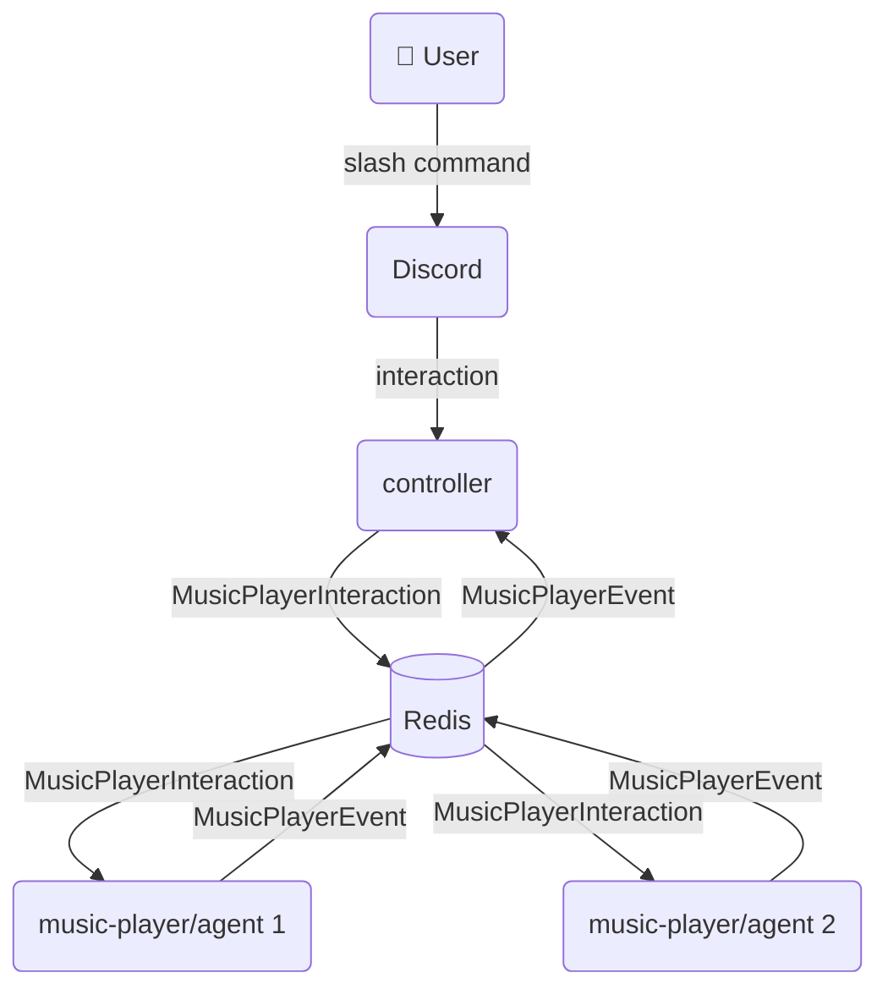

# Bearify Discord Bot

[](https://github.com/HugaertsDries/bearify-discord-bot/actions/workflows/build.yml)

A Discord music bot built with Java 25 and Spring Boot. Uses a controller + player architecture where a main bot handles user commands and separate player agents handle audio playback per guild.

## Architecture



- **controller** — the bot users interact with. Receives slash commands, dispatches `MusicPlayerInteraction`s to player agents over Redis, and posts feedback messages back to Discord text channels when it receives `MusicPlayerEvent`s.
- **music-player/agent** — audio player agent. Each instance can serve multiple guilds simultaneously using LavaPlayer. Multiple agents can run in parallel, each with its own Discord bot token.

## Modules

| Module | Description |
|---|---|
| [`discord/api`](discord/api/README.md) | Pure Java interfaces — `DiscordClient`, `Guild`, `TextChannel`, `AudioProvider`, `CommandInteraction` |
| [`discord/jda`](discord/jda/README.md) | JDA 6 implementation of `discord-api` |
| [`discord/starter`](discord/starter/README.md) | Spring Boot auto-configuration — `@DiscordController`, `@InteractionGroup`, `@Interaction`, `@Option` |
| [`discord/testing`](discord/testing) | Test doubles — `MockDiscordClient`, `MockCommandInteraction` |
| [`music-player/bridge`](music-player/bridge) | Shared protocol — `MusicPlayerInteraction`, `MusicPlayerEvent`, `TrackMetadata`, `TrackRequest` |
| [`controller`](controller/README.md) | Main bot application |
| [`music-player/agent`](music-player/agent) | Audio player agent |

## Tech Stack

- Java 25
- Spring Boot 4.1.1
- JDA 6.7.0
- LavaPlayer 2.2.7
- youtube-source (pinned snapshot, see `gradle/libs.versions.toml`)
- Redis (pub/sub + player registry)

## Prerequisites

- JDK 25
- Docker (for local Redis)

## Getting Started

**1. Start infrastructure:**
```bash
docker compose up -d
```

**2. Configure environment — copy `.env.example` and fill in your values (unquoted `KEY=value`):**
```bash
cp .env.example .env
```

Both apps import `.env` from their working directory, so run them from the repo root. `bootRun` already does; for an IDE run configuration, set the working directory to the repo root.

**3. Run the controller:**
```bash
./gradlew :controller:bootRun
```

**4. Run a player agent:**
```bash
./gradlew :music-player:agent:bootRun
```

A bear needs **Connect** and **Speak** in the voice channels it joins, and **Set Voice Channel Status** to show the playing track as the channel's status (without it, it plays on and logs one warning). Its settings:

| Property | Default | Description |
|---|---|---|
| `music-player.default-volume` | `100` | The volume, 0 to 100, the bear starts every visit at |
| `music-player.voice-session.nobody-listening-timeout` | `5m` | The bear pauses when it's alone and leaves once it has been alone this long |
| `music-player.voice-session.idle-timeout` | `10m` | The bear leaves once it has played nothing, or sat paused, this long |
| `music-player.health.probe-url` | a YouTube video | The track the YouTube health check plays |
| `music-player.health.probe-timeout` | `20s` | How long the health check may take to load and play the first frame |

## Building

```bash
./gradlew build
```

Tests need Docker running: they start Redis with Testcontainers.

> On Windows, set `JAVA_HOME` to your JDK 25 installation before running Gradle.

## CI

Every push and pull request runs `./gradlew build` on GitHub Actions (`.github/workflows/build.yml`). Test results are published as a "JUnit Test Report" check: the counts appear on the run summary, and failures are annotated on the failing test.

The Docker images skip tests (`-x test`), so let Railway wait for that check before deploying. Enable **Settings → Deploy → Wait for CI** on both the controller and the agent service. A deploy then waits while the workflow runs and is skipped if it fails.

- The toggle only appears once a workflow runs on `push` to the deploy branch.
- A manual Redeploy bypasses the check.
- If a deploy gets stuck in WAITING, use **Deploy latest commit**.

### Stopping the agent

A stopping agent deletes its player messages on the way out, which needs a few seconds between Railway's stop signal and the kill. Give the agent service a draining window, e.g. the service variable `RAILWAY_DEPLOYMENT_DRAINING_SECONDS=15` (check the name in Railway's deployment docs). Without it the controller still cleans up once it notices the bear is gone, but up to a minute later and with a "lost my connection" note.

`bearify.liveness.interval` (default `5s`) sets how often the controller checks that the bears behind its player messages are still there. A bear counts as lost once its Redis assignment has been missing on two checks in a row and Discord no longer shows it in a voice channel.
